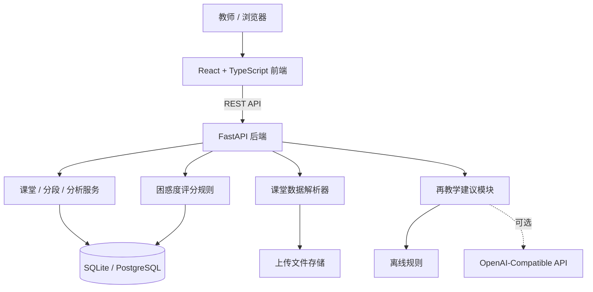

# 课堂困惑雷达 Class Confusion Radar

> 面向编程课堂教师的课后复盘与再教学辅助系统：将测验、代码提交、课堂互动、讲稿和 PPT 时间轴统一到课堂时间线中，自动定位群体困惑时刻，并形成可解释、可追溯、可核验的教学改进闭环。

---

## 项目简介

在编程课堂中，教师往往能看到期末成绩或作业结果，却很难快速回答三个更具体的问题：

1. **学生究竟在哪个教学片段开始出现集中困惑？**
2. **困惑是测验错误、代码提交失败、重复错误，还是课堂互动不足造成的？**
3. **进行再教学之后，学生在后续课堂中是否真正得到改善？**

“课堂困惑雷达”围绕这三个问题，将多源课堂数据映射到统一教学时间线，自动构建教学分段，对每个分段计算困惑得分、风险等级、数据完整度与可信度，并进一步生成再教学建议、记录教师干预、核验后续效果。

系统默认采用**本地可解释规则**完成核心分析，即使在断网环境下也可以运行；如配置兼容 OpenAI 接口的模型，还可以启用 AI 增强分析与建议生成。

---

## 核心功能

| 模块 | 功能 |
| --- | --- |
| 课堂管理 | 创建、查看、编辑和删除课堂场次 |
| 多源数据接入 | 支持测验、代码提交、课堂互动、讲稿、PPT 时间轴五类数据 |
| ZIP 一键导入 | 将多类课堂数据及知识点配置一次性导入 |
| 教学分段 | 根据讲稿、PPT 时间窗与知识点自动构建课堂教学片段 |
| 困惑分析 | 计算困惑得分、风险等级、数据完整度、可信度和证据链 |
| 错误分析 | 汇总代码提交失败情况与重复错误，定位反复卡点 |
| 可视化展示 | 使用热力图、指标卡、错误统计和高风险分段展示分析结果 |
| 再教学建议 | 默认离线规则生成，可选 AI 增强模式 |
| 干预追踪 | 记录教师采纳的再教学建议与对应干预 |
| 效果核验 | 使用后续课堂同知识点数据自动比较干预前后困惑得分 |
| 报告导出 | 困惑分析、课堂解读和教学建议均可打开打印版并另存 PDF |
| 隐私保护 | 默认对学生标识稳定匿名化，并在删除课堂时清理关联数据 |
| 桌面运行 | 支持构建 Windows EXE，本地 SQLite 运行，无需额外部署数据库 |

---

## 教学闭环


系统并不只给出“哪里有问题”，而是尽量形成：

**数据 → 分段 → 评分 → 证据 → 建议 → 干预 → 核验**

的完整教学改进链路。

---

## 技术栈

### 前端

- React 18
- TypeScript
- Vite
- Ant Design
- ECharts / echarts-for-react
- React Router
- Vitest

### 后端

- Python 3.9+
- FastAPI
- SQLAlchemy 2
- Alembic
- Pydantic Settings
- Uvicorn
- Pytest

### 数据与部署

- 本地 / Windows EXE：SQLite
- Docker 部署：PostgreSQL 15
- 文件上传：本地存储目录
- 桌面封装：PyInstaller

---

## 系统架构



---

## 项目目录

```text
ClassConfusionRadar-Source/
├─ assets/                    # 应用图标等资源
├─ backend/                   # FastAPI 后端、数据库模型、服务与测试
│  ├─ alembic/                # 数据库迁移
│  ├─ app/                    # 后端核心代码
│  ├─ storage/uploads/        # 上传文件存储目录
│  └─ tests/                  # 后端自动化测试
├─ frontend/                  # React + TypeScript 前端
│  └─ src/                    # 页面、组件、API 与业务功能
├─ demo_data/                 # 批量测试数据与现场演示数据
├─ docs/                      # 数据模板、评分规则、API、EXE 说明
├─ infra/                     # PostgreSQL 初始化配置
├─ scripts/                   # 演示、数据生成、构建与发布脚本
├─ desktop_launcher.py        # Windows 桌面版启动入口
├─ ClassConfusionRadar.spec   # PyInstaller 配置
├─ docker-compose.yml         # 开发 / 演示 Docker 编排
├─ BuildExe.bat               # Windows EXE 构建入口
├─ Run.bat                    # Windows 演示环境启动入口
└─ Stop.bat                   # Windows 演示环境停止入口
```

---

## 快速开始

### 方式一：Windows 演示环境

源码包根目录提供：

```text
Run.bat
Stop.bat
```

运行 `Run.bat` 后，脚本会检查运行环境、启动 Docker Compose、等待前后端服务就绪、准备演示数据并自动打开浏览器。

源码演示模式需要：

- Windows
- Docker Desktop（含 Docker Compose）
- Python 3.9+（用于演示数据初始化）

默认访问地址：

```text
前端：http://127.0.0.1:5173
API：http://127.0.0.1:8000
API 文档：http://127.0.0.1:8000/docs
```

停止服务可双击：

```text
Stop.bat
```

---

### 方式二：源码开发运行

#### 1. 后端

进入后端目录：

```powershell
cd backend
```

安装依赖：

```powershell
py -m pip install -e ".[dev]"
```

如果尚未创建配置文件，可复制示例配置：

```powershell
copy .env.example .env
```

初始化 / 升级数据库：

```powershell
py -m alembic upgrade head
```

启动后端：

```powershell
py -m uvicorn app.main:app --host 127.0.0.1 --port 8000 --reload
```

#### 2. 前端

新开一个终端：

```powershell
cd frontend
npm ci
npm run dev
```

默认访问：

```text
前端：http://127.0.0.1:5173
Swagger：http://127.0.0.1:8000/docs
```

---

### 方式三：Docker Compose

在项目根目录执行：

```powershell
docker compose up --build
```

默认会启动：

- PostgreSQL
- FastAPI 后端
- React/Vite 前端

Docker 环境中的后端会自动执行 Alembic 数据库迁移。

---

## 使用流程

推荐按照以下顺序操作：

1. 创建一节课堂；
2. 上传五类课堂数据，或直接导入 ZIP 数据包；
3. 检查 / 创建知识点；
4. 自动生成或手动维护教学分段；
5. 运行困惑分析；
6. 查看课堂热力图、高风险分段、错误统计和证据链；
7. 对重点分段生成再教学建议；
8. 将已执行的建议标记为教师干预；
9. 在后续同课程课堂中自动核验同知识点的困惑得分变化；
10. 打开打印版报告并按需另存为 PDF。

---

## 支持的数据

系统支持：

- CSV
- XLSX
- XLSM
- 多文件 ZIP 数据包

CSV 推荐使用 UTF-8 编码，同时会尝试识别 GBK / GB18030。

### 1. 测验数据 `quiz`

必填字段：

```text
student_code,question_code,score,is_correct,event_minute
```

可选：

```text
student_name
```

### 2. 代码提交 `submission`

必填字段：

```text
student_code,task_name,language,result_status,event_minute
```

可选：

```text
student_name,error_type,error_message
```

### 3. 课堂互动 `interaction`

必填字段：

```text
student_code,event_type,event_minute
```

可选：

```text
student_name,value
```

### 4. 课堂讲稿 `transcript`

必填字段：

```text
start_minute,end_minute,text
```

可选：

```text
speaker
```

### 5. PPT 时间轴 `ppt_timeline`

必填字段：

```text
slide_index,start_minute,end_minute
```

可选：

```text
slide_title
```

所有时间字段统一使用“**从本节课开始计算的分钟数**”，支持小数，例如 `12.5`。

更完整的数据模板说明见：

```text
docs/data-templates.md
```

---

## ZIP 一键导入

ZIP 内可以同时放置五类数据文件，目录层级不限。文件名包含对应英文或中文关键词即可，例如：

```text
课堂测验_quiz.csv
编程提交_submission.csv
interaction.csv
课堂讲稿_transcript.csv
ppt_timeline.csv
manifest.json
```

其中 `manifest.json` 可用于预置知识点，例如：

```json
{
  "knowledge_points": [
    {"name": "条件判断", "topic_area": "Python 基础"},
    {"name": "while 循环", "topic_area": "Python 基础"}
  ]
}
```

每种数据类型在一个 ZIP 中只应出现一份，避免重复文件造成导入歧义。

默认 ZIP 大小上限由以下环境变量控制：

```text
MAX_DATASET_ZIP_MB=30
```

---

## 困惑度评分规则

系统使用**可解释规则**计算教学分段风险，不使用黑箱模型直接决定风险等级。

基础权重如下：

| 信号 | 基础权重 | 含义 |
| --- | ---: | --- |
| 测验错误率 | 35% | 当前分段测验中的错误作答比例 |
| 提交失败率 | 35% | 当前分段编程提交中的非 success 比例 |
| 重复错误密度 | 20% | 同一学生反复出现同一错误的程度 |
| 互动沉默度 | 10% | 有名册和互动证据时，未参与互动的学生比例 |

### 缺失信号不会按 0 分处理

如果某个信号缺失，它会退出当前加权计算，而不是被当成“没有问题”。

计算思想：

```text
困惑得分
= 已存在信号的加权结果 / 已存在信号的权重总和 × 100
```

例如当前分段只有：

```text
提交失败率 = 80%
重复错误密度 = 40%
```

则：

```text
(0.35 × 0.80 + 0.20 × 0.40) / (0.35 + 0.20) × 100
= 65.45
```

同时系统会单独给出：

```text
数据完整度 = 55%
可信度 = 中可信
```

因此，“**风险高低**”与“**证据是否充分**”不会混为一谈。

### 风险等级

| 得分 | 风险等级 |
| ---: | --- |
| 0 ～ 39.99 | Low |
| 40 ～ 59.99 | Medium |
| 60 ～ 79.99 | High |
| 80 ～ 100 | Critical |

### 可信度

| 数据完整度 | 可信度 |
| ---: | --- |
| 80% ～ 100% | 高可信 |
| 50% ～ 79.99% | 中可信 |
| < 50% | 低可信 |

详细规则见：

```text
docs/scoring-rules.md
```

---

## 重复错误密度

“重复错误密度”与普通的“提交失败率”分开计算。

例如，同一学生连续出现三次 `OffByOne`：

```text
第一次：错误暴露，不计重复
第二次：重复 1 次
第三次：再重复 1 次
```

计算方式：

```text
重复错误密度 = 重复错误次数 / 当前分段全部提交次数
```

这样可以区分：

- **提交失败率**：有多少提交没有通过；
- **重复错误密度**：同一个问题是否被学生反复卡住。

---

## 再教学建议

系统默认配置：

```text
AI_PROVIDER=offline
```

此时建议由本地规则生成，界面会明确标识为离线可解释建议，不依赖网络，也不会将模板结果伪装成大模型输出。

如需接入兼容 OpenAI 接口的模型，可在 `backend/.env` 中配置：

```text
AI_PROVIDER=openai-compatible
AI_API_KEY=你的_API_Key
AI_BASE_URL=兼容接口地址
AI_MODEL=模型名称
```

只有配置有效的 API Key 后，系统才会实际切换到 AI 增强模式。

---

## 干预效果核验

系统支持将“建议”继续推进到“干预效果”。

教师可以在分段详情中将某条建议标记为已采纳。当后续同课程课堂出现同名知识点并完成分析后，系统可自动寻找最近一次后续课堂，对比该知识点的困惑得分，并保存：

- 干预前得分
- 干预后得分
- 得分变化
- 对应后续课堂
- 后续课堂日期

由此形成从“发现问题”到“验证改进效果”的闭环。

---

## 隐私保护

默认开启学生标识匿名化：

```text
ANONYMIZE_STUDENTS=true
```

因此数据文件仅要求 `student_code`，`student_name` 为可选字段。

系统保存数据时会根据本地盐值进行稳定映射。正式环境建议修改：

```text
PRIVACY_SALT=你自己的随机字符串
```

如果确实需要保留原始学生标识，可以设置：

```text
ANONYMIZE_STUDENTS=false
```

删除课堂时，系统还会同步清理该课堂上传目录，并清理不再被其他课堂引用的孤立学生记录。

---

## 报告导出

当前前端在以下板块提供独立打印功能：

- 困惑分析
- 课堂解读
- 教学建议

点击“**打开打印版 / 另存 PDF**”后，只会打印当前板块生成的内容，浏览器打印窗口中可以直接选择“另存为 PDF”。

后端同时保留：

```text
GET /api/v1/sessions/{session_id}/analytics/report.md
GET /api/v1/sessions/{session_id}/analytics/report.html
```

便于后续二次开发或接入其他报告系统。

---

## 演示数据

项目自带：

- **20 组批量测试数据**
- **1 组现场演示数据**
- **105 个 CSV 文件**
- **13,771 行有效 CSV 数据记录**（不含表头）

所有学生记录均为程序生成的**合成测试数据**，不对应真实学生。

### 批量测试主题

1. Python 条件与循环
2. Python 函数与参数
3. C 数组与指针
4. 数据结构：栈与队列
5. 数据结构：链表
6. 算法：二分查找
7. 算法：递归与回溯
8. C++ 类与对象
9. SQL 连接查询
10. Web API 与异步
11. Java 集合框架
12. 操作系统：进程与线程
13. 计算机网络：TCP 可靠传输
14. 数据库：事务与并发
15. 软件工程：设计模式
16. 人工智能：搜索算法
17. 机器学习：分类模型
18. 前端开发：React 状态管理
19. 信息安全：密码学基础
20. 嵌入式：传感器采集

数据目录：

```text
demo_data/批量测试数据/
```

现场演示目录：

```text
demo_data/现场演示_手动输入版/
```

如需重新生成测试数据：

```powershell
python scripts/generate_test_datasets.py
```

---

## API

API 基础路径：

```text
/api/v1
```

主要接口覆盖：

- 课堂场次管理
- 文件上传与 ZIP 数据包导入
- 知识点管理
- 教学分段与自动分段
- 困惑分析
- 分段分析详情
- Markdown / HTML 报告
- 再教学建议
- 教师干预
- 后续课堂效果核验
- 增强分析

启动后可直接查看 Swagger：

```text
http://127.0.0.1:8000/docs
```

完整接口速查见：

```text
docs/api-contract.md
```

---

## 测试

### 后端

执行：

```powershell
cd backend
py -m pytest -q
```

当前源码实际测试结果：

```text
46 passed
```

覆盖内容包括：

- 基础 CRUD
- 五类课堂数据上传
- ZIP 一键导入
- `manifest.json` 知识点导入
- 缺失数据权重重新归一化
- 重复错误密度
- 自动分段与连续页面合并
- 干预效果自动核验
- 隐私匿名化与删除清理
- OpenAPI 路由契约检查
- 批量测试数据完整性
- 现场演示包端到端流程

### 前端

执行：

```powershell
cd frontend
npm test
```

生产构建：

```powershell
npm run build
```

---

## Windows EXE

项目保留完整 Windows EXE 构建链路。

执行：

```text
BuildExe.bat
```

构建过程会先生成前端生产文件，再通过 PyInstaller 将桌面启动器、后端代码、前端静态资源、样例数据等一起打包为：

```text
ClassConfusionRadar.exe
```

桌面版默认：

- 使用本地 SQLite；
- 自动创建运行目录；
- 自动启动本地服务；
- 自动打开浏览器；
- 不要求单独安装 Node.js；
- 构建完成后的 EXE 运行时不要求单独安装 Python；
- 不依赖 Docker Desktop。

默认地址：

```text
http://127.0.0.1:8000
```

如端口 `8000` 被占用，可在 PowerShell 中设置：

```powershell
$env:CCR_PORT="8010"
.\ClassConfusionRadar.exe
```

详细说明见：

```text
docs/desktop-exe.md
```

---

## 主要环境变量

后端示例配置位于：

```text
backend/.env.example
```

常用配置：

| 变量 | 默认 / 示例值 | 作用 |
| --- | --- | --- |
| `APP_ENV` | `development` | 运行环境 |
| `DATABASE_URL` | `sqlite:///./local.db` | 数据库连接 |
| `API_V1_PREFIX` | `/api/v1` | API 前缀 |
| `STORAGE_DIR` | `./storage/uploads` | 上传文件目录 |
| `AI_PROVIDER` | `offline` | 建议 / AI 模式 |
| `AI_MODEL` | `gpt-4o-mini` | AI 模型名 |
| `AI_API_KEY` | 空 | API Key |
| `AI_BASE_URL` | 兼容接口地址 | AI API 地址 |
| `ANONYMIZE_STUDENTS` | `true` | 是否匿名化学生标识 |
| `PRIVACY_SALT` | 本地默认值 | 匿名映射盐值 |
| `MAX_DATASET_ZIP_MB` | `30` | ZIP 上传大小上限 |

---

## 相关文档

```text
docs/data-templates.md   数据文件字段与 ZIP 导入格式
docs/scoring-rules.md    困惑度评分、完整度与可信度规则
docs/api-contract.md     API 路由速查
docs/desktop-exe.md      Windows EXE 使用说明
demo_data/README.md      测试与演示数据说明
```

---

## 项目特点

- **多源融合**：不依赖单一成绩指标，而是联合测验、提交、互动、讲稿和 PPT 时间线。
- **时间定位**：分析对象从“整节课”下沉到具体教学分段与知识点。
- **可解释评分**：每个得分都可以回溯到具体信号、权重和数据完整度。
- **避免缺失误判**：没有数据不等于没有问题，缺失信号不会自动按 0 分处理。
- **关注重复卡点**：将“提交失败”与“同一错误反复出现”分开建模。
- **再教学闭环**：从发现问题、生成建议一直追踪到后续课堂效果核验。
- **离线可运行**：核心分析与建议不强依赖外部 AI 服务，适合课堂和比赛现场。
- **隐私优先**：默认匿名化学生标识，并提供数据删除清理机制。
- **多种运行方式**：支持源码开发、Docker Compose 和 Windows EXE。

---

## 项目定位

“课堂困惑雷达”不是用 AI 替代教师判断，而是把原本分散在多个系统、多个文件中的课堂证据重新组织起来，让教师能够更快发现：

> **哪里出现了困惑、为什么出现困惑、应该优先处理什么，以及处理之后是否真正改善。**

这也是项目从“课堂数据统计工具”走向“可解释教学复盘与再教学闭环系统”的核心目标。
